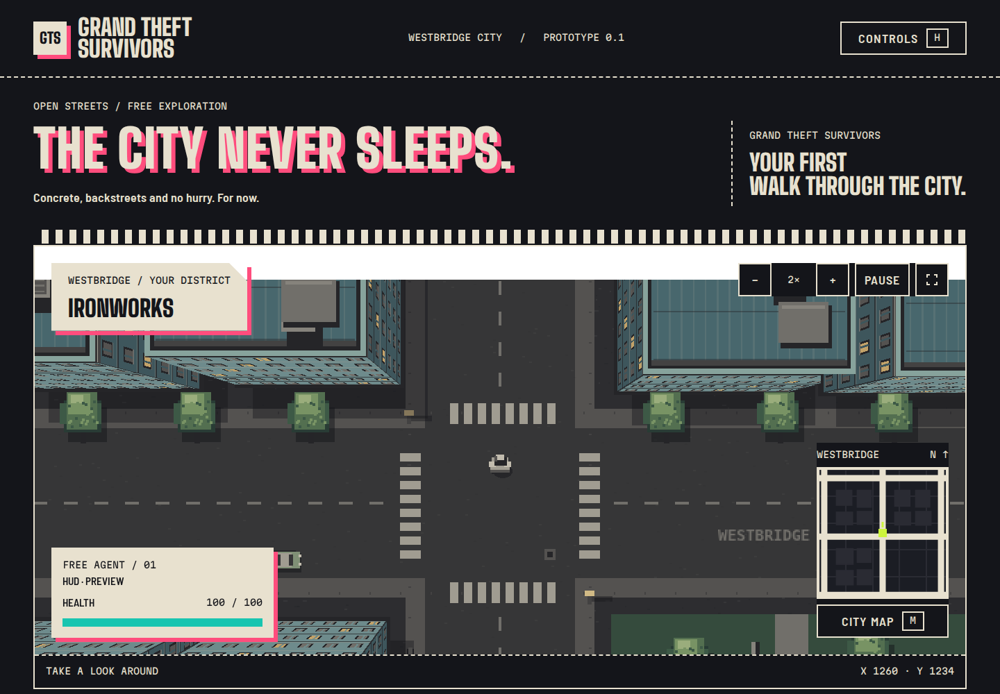

# Grand Theft Survivors

A browser game prototype combining a top-down city sandbox with the planned progression of a survival action game. Built with **Phaser 3.90, strict TypeScript and Vite 7**, with original procedural graphics and the Kerbside interface design system.



## Play locally

Use Node.js **22.12+** and npm. The project uses one `package-lock.json` and Phaser's bundled TypeScript definitions.

```sh
npm ci
npm run dev
```

Open [the game](http://localhost:5173/) or the [Kerbside component reference](http://localhost:5173/design-system/kerbside-design-system/components.html). The interface adapts to small screens; movement currently requires a keyboard. Fonts are served locally.

| Input                 | Action                          |
| --------------------- | ------------------------------- |
| W / Up                | Walk forward                    |
| S / Down              | Walk backward at the same speed |
| A / D or Left / Right | Turn                            |
| Shift + forward       | Run                             |
| M                     | Toggle city map                 |
| Esc                   | Pause / resume                  |
| H / Controls button   | Help                            |
| Mouse wheel / − / +   | Camera zoom                     |

## Current prototype

Explore Westbridge: a deterministic 2520 × 2520 city with three district material palettes, parks, side streets and decorative parked cars. The player walks, turns and runs, collides with buildings/world boundaries, and is followed by a camera with projected high roofs and facades. Minimap, full map, pause/help dialogs, camera zoom and position reset are implemented.

**Combat, enemies, XP, bosses, traffic and sound are not implemented.** Health is explicitly a HUD preview; parked cars and trees are scenery without collision. The current block grid is a prototype, not the final city design.

The intended direction is a living city where player actions build hostility with three gangs and the police, provoking raids and faction bosses. Weapons and upgrades will be configurable. Future systems require design review before implementation; see [Design](docs/DESIGN.md).

## Development and verification

```sh
npm run theme:build    # regenerate CSS after editing token JSON
npm run typecheck     # Vite does not type-check
npm run lint
npm run format:check
npm run test:unit
npx playwright install chromium
npm run test:e2e
npm run check         # all of the above checks, plus production build
npm run build         # output: dist/
npm run preview       # serve production build on port 4173
```

`npm run check` checks theme synchronization/usage, types, lint, formatting, unit contracts, build and Chromium behavior. E2E covers movement, collisions, perspective, dialogs, keyboard focus, scene restarts, local fonts, English accessibility and mobile layout. The Phaser bundle warning remains visible; engine code is split into its own cacheable chunk.

## Project layout

- `src/app`: application composition, resizing and cleanup.
- `src/game/scenes`: scene lifecycle and feature coordination.
- `src/game/features`: player, world generation/rendering and map drawing.
- `src/shared`: engine-independent contracts, session/events, math and localization.
- `src/theme`: adapters for canonical Kerbside tokens.
- `src/ui`: semantic HTML interface, dialogs, HUD and styles.
- `design-system/kerbside-design-system`: canonical tokens and components.
- `tests`: unit contracts, browser scenarios and lifecycle fixture.

All player-facing copy uses the English catalog in `src/shared/intl/en.ts`, including accessibility and Canvas labels. Additional languages are planned; no other locale or language selector ships yet.

## Documentation

- [Architecture](docs/ARCHITECTURE.md) — boundaries, lifecycle and verification.
- [Design](docs/DESIGN.md) — current state and intended gameplay.
- [Localization](docs/LOCALIZATION.md) — keys, interpolation and adding locales.
- [Theming](docs/THEMING.md) — Kerbside roles and world materials.
- [Art pipeline](docs/ART-PIPELINE.md) — how graphics work and external asset options.
- [Audio candidates](docs/AUDIO-CANDIDATES.md) — preliminary research, not integrated assets.
- [Third-party assets](docs/THIRD-PARTY-ASSETS.md) — used assets and retained licenses.
- [Agent rules](AGENTS.md) — contribution and architecture constraints.

## Assets and project status

World graphics are generated by project code. Font licenses are retained in `public/licenses/` and linked from the interface. Reference screenshots under `sources/` are research material and are not shipped in the game build. GTA 2 and Vampire Survivors are design references; their assets are not used in the playable prototype.

This repository is currently private. No open-source license has been selected for project code or original art. Dependency and third-party asset licenses apply separately. A public release and its licensing are separate decisions.
