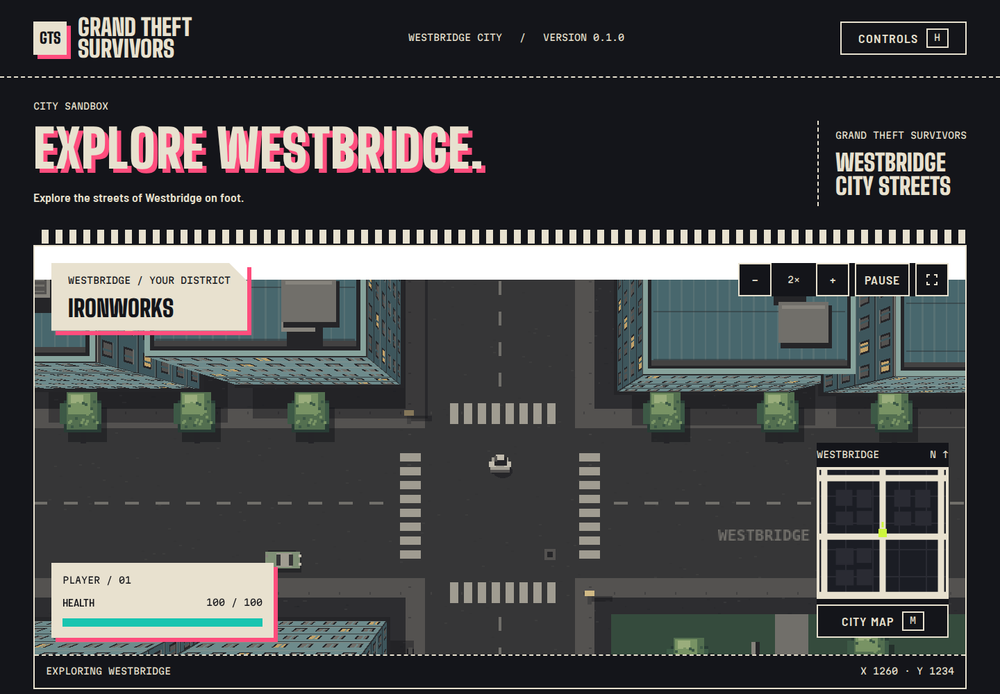

# Grand Theft Survivors

A top-down city game built with Phaser 3.90, TypeScript and Vite 7. Explore Westbridge on foot, with building collisions, a following camera and a Kerbside interface.

[Play in your browser](https://jakubfalenczyk.github.io/grand-theft-survivors/). A keyboard is required to move.



## Current version

Westbridge has a seeded 2520 × 2520 layout with three district palettes, parks and parked cars. Roofs and facades shift with the camera to show building height. The interface includes a minimap, city map, pause, controls, zoom and position reset.

Combat, enemies, XP, bosses, moving traffic and sound are planned. The health display currently shows a fixed value. Cars and trees are scenery without collision.

The planned game uses player actions to raise hostility with three gangs and the police. Hostile factions send reinforcements and bosses. See the [design](docs/DESIGN.md) and [backlog](docs/BACKLOG.md) for the agreed rules and proposals.

## Run locally

Install Node.js 22.12 or later and npm, then run:

```sh
npm ci
npm run dev
```

Open [the local game](http://localhost:5173/). The [Kerbside reference](http://localhost:5173/design-system/kerbside-design-system/components.html) shows the shared interface styles. The game serves fonts locally.

| Input                 | Action                     |
| --------------------- | -------------------------- |
| W / Up                | Walk forward               |
| S / Down              | Walk backward              |
| A / D or Left / Right | Turn                       |
| Shift + forward       | Run                        |
| M                     | Open or close the city map |
| Esc                   | Pause or resume            |
| H                     | Show controls              |
| Mouse wheel / − / +   | Change camera zoom         |

## Check and build

```sh
npm run check         # theme, types, lint, formatting, tests and build
npm run theme:build   # regenerate CSS after editing tokens.json
npm run typecheck     # check TypeScript separately
npm run test:unit
npx playwright install chromium
npm run test:e2e
npm run build         # create dist/
npm run preview       # preview dist/ on port 4173
```

Use `npm run format` to format files. Vite does not check TypeScript types during a build. Keep `package-lock.json` as the only package-manager lockfile. Phaser supplies its own TypeScript types.

The tests cover world generation, projection, movement, collisions, dialogs, focus, scene restarts, fonts, English labels and mobile layout. Small screens support the interface; touch movement is not available. Vite reports a size warning for the Phaser chunk, which is about 1.2 MB before gzip.

## Project files

| Path                                   | Contents                                               |
| -------------------------------------- | ------------------------------------------------------ |
| `src/app`                              | Application setup, resize handling and cleanup         |
| `src/game/scenes`                      | Scene lifecycle                                        |
| `src/game/features`                    | Player, city generation, rendering and map drawing     |
| `src/shared`                           | Data contracts, events, session, math and localization |
| `src/theme`                            | Kerbside token adapters                                |
| `src/ui`                               | HTML interface, HUD, dialogs and styles                |
| `design-system/kerbside-design-system` | Shared tokens and CSS components                       |
| `tests`                                | Unit and browser tests                                 |

All player-facing text comes from `src/shared/intl/en.ts`. English is the only current language.

## Documentation

- [Game terminology](GLOSSARY.md)
- [Architecture review](docs/ARCHITECTURE-REVIEW.md)
- [Architecture](docs/ARCHITECTURE.md)
- [Game design](docs/DESIGN.md)
- [Planned tasks and decisions](docs/BACKLOG.md)
- [GitHub Pages deployment](docs/PUBLISHING.md)
- [Localization](docs/LOCALIZATION.md)
- [Kerbside integration](docs/THEMING.md)
- [Graphics and asset formats](docs/ART-PIPELINE.md)
- [Audio candidates](docs/AUDIO-CANDIDATES.md)
- [Third-party assets and licenses](docs/THIRD-PARTY-ASSETS.md)
- [Agent instructions](AGENTS.md)

## License

The original project code and documentation use the [MIT license](LICENSE). Copyright 2026 Jakub Falenczyk. You may use, modify and distribute them, including commercially, provided you retain the copyright and license notices.

Fonts and software dependencies keep their own licenses. The game lists font credits and full licenses in its interface. GTA 2 and Vampire Survivors are design references. Their sprites, logos and audio are not part of the playable game. Screenshots in `sources/` are reference material and are excluded from the project's MIT license and game build.
