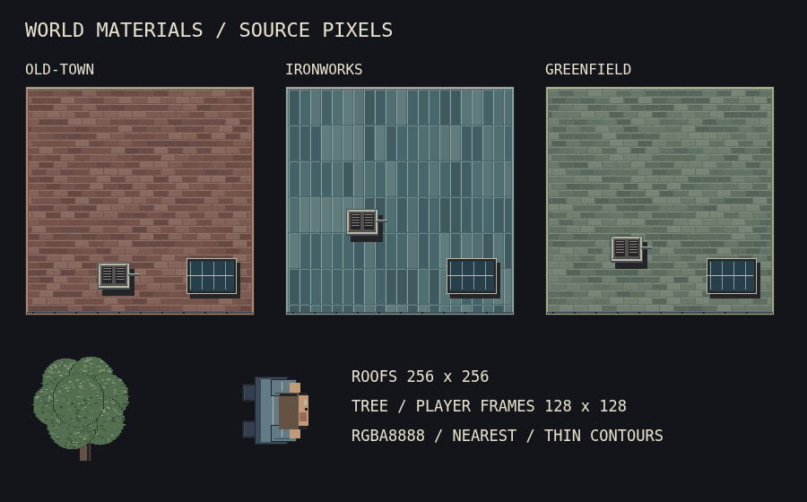

# Detailed world pixel art

Accepted 2026-10-25. This is the world-art standard for Kerbside.

## Terms and style choices

Pixel art has independent choices of subject, projection, source resolution, palette, contour and shading. Common approaches include limited-palette console art, outlined sprites, selective outlines, lineless material clusters, top-down tiles and isometric scenes. None of these requires a particular bit depth. Canvas size alone does not create detail.

An indexed image can address 2^n colors with n bits per pixel: 4 bits gives 16 entries, 8 bits gives 256 and 16 bits gives 65,536. Historic console labels such as "16-bit style" describe a family of hardware aesthetics, not a mandatory palette size. RGBA8888 stores red, green, blue and alpha in four 8-bit channels. It provides 16,777,216 RGB combinations and 256 alpha levels. See [Aseprite color modes](https://www.aseprite.org/api/colormode).

The supplied [pixel-art tutorial image](https://static.wikia.nocookie.net/pixelstudiotutorial/images/f/f9/13_tutorial.png/revision/latest?cb=20190829123433) could not be fetched during review. Both supplied original links point to the same PNG, including the link labelled SVG. The implementation follows the owner's written requirements.

## Required world-art rules

- Author standalone world textures and animation frames at least 128 × 128 source pixels. Roofs use at least two source pixels per world unit and increase density for small footprints. Larger buildings keep larger textures. The integrated ground canvas is 2520 × 2520; cars, paths and small street furniture painted into it are details within that canvas, not separate padded sprites.
- Use 32-bit RGBA, with no indexed-color cap. Build rich, coherent material ramps from `world.materials` through `materialShade`. Keep material hue variation subordinate to silhouettes and navigation. Do not scatter arbitrary RGB noise across surfaces.
- Use one source pixel for outer roof/prop contours and leaf-cluster silhouettes. Thin internal seams and selective material-colored outlines describe form. Hard cast shadows remain distinct from outlines. Projected facade edges use a one-pixel Graphics stroke.
- Add actual structure: staggered roof tiles or standing metal seams, coping and gutters, vent louvers and bolts, framed glass, wall joints, pavement slabs and drain grilles. Leaves form stepped clusters with small highlight groups. Detail must describe a material or object.
- Keep source drawing coordinates on the pixel grid and use nearest-neighbor sampling. No smoothing, blur, glow or soft gradients. Discrete ramp steps and hard shadows describe light. Projected walls and rotated sprites still move continuously; camera zoom and perspective can resample pixels at noninteger screen sizes.
- Keep source resolution separate from world dimensions. The character remains 24 × 24 world units with its original 10 × 10 collision footprint. Trees remain 38 × 42 world units. Do not enlarge physics bodies or movement speeds to display more source pixels.
- Keep UI fonts, semantic accent roles, chamfers, shadows and 48 px targets. World materials do not signal faction ownership. The minimap keeps its simplified navigation style.
- Generate textures once using independent seeded decorative streams. Reuse stable texture keys on restart. More detail must not add per-frame random drawing or mutate generated layout data.

`tokens.world.pixel-art` contains the minimum frame size, roof density, outline, RGBA and filtering specification. A 128 × 128 image only meets this standard if it contains detail at that resolution. Enlarging a small bitmap or adding transparent padding does not count.

## Review

Inspect the normal play camera, close zoom and all three districts. Check thin contours, roof material differences, prop silhouettes, pavement detail and player readability. Confirm unchanged projection/footprints and scene-restart resource counts. Run `npm run check`. The source-frame requirement does not guarantee that every pixel remains visible at the default camera zoom.

## Rendered reference

These samples come from the game texture generators at source resolution. Roofs are 256 × 256; tree and character frames are 128 × 128.

See [the desktop game view](../game-desktop.png) and [the moving perspective view](../perspective-in-motion.png) for the same materials at gameplay scale.
